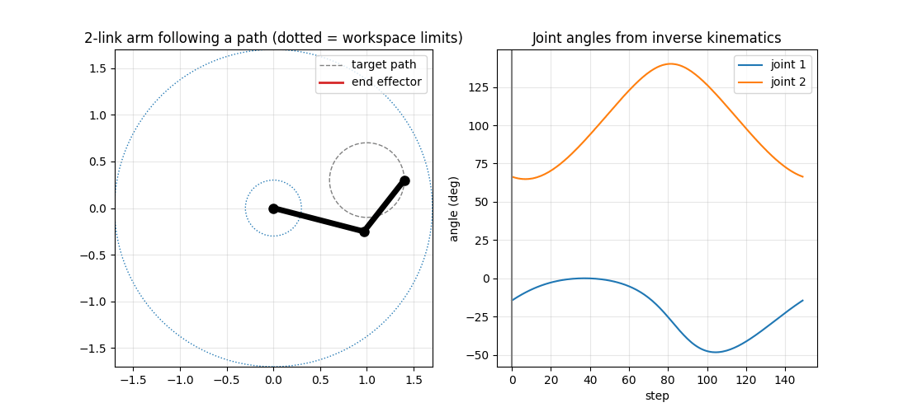

# 2-Link Planar Robot Arm Simulation

Forward and inverse kinematics of a 2-link planar arm in Python, with an animation of the end effector tracing a path while the joint angles are solved at every step.



## Run it

```bash
pip install -r requirements.txt
python arm.py                  # circle path, opens a window
python arm.py --path line      # straight-line path
python arm.py --save out.gif   # save the animation
```

## The maths

Link lengths `L1`, `L2`; joint angles `t1`, `t2`.

**Forward kinematics**

```
x = L1*cos(t1) + L2*cos(t1 + t2)
y = L1*sin(t1) + L2*sin(t1 + t2)
```

**Inverse kinematics** (law of cosines)

```
cos(t2) = (x^2 + y^2 - L1^2 - L2^2) / (2*L1*L2)
t2 = atan2(+/- sqrt(1 - cos(t2)^2), cos(t2))
t1 = atan2(y, x) - atan2(L2*sin(t2), L1 + L2*cos(t2))
```

The `+/-` gives two valid solutions (elbow up or elbow down). If `|cos(t2)| > 1` the point is outside the workspace, an annulus between `|L1 - L2|` and `L1 + L2`.

## Checked

Inverse then forward kinematics returns the original target for both elbow configurations.

## Next steps

- [ ] Add joint limits and pick the elbow solution that respects them
- [ ] Add a 3rd link and handle redundancy
- [ ] Jacobian-based velocity control and singularity detection
- [ ] Port the same model to ROS 2 and RViz
